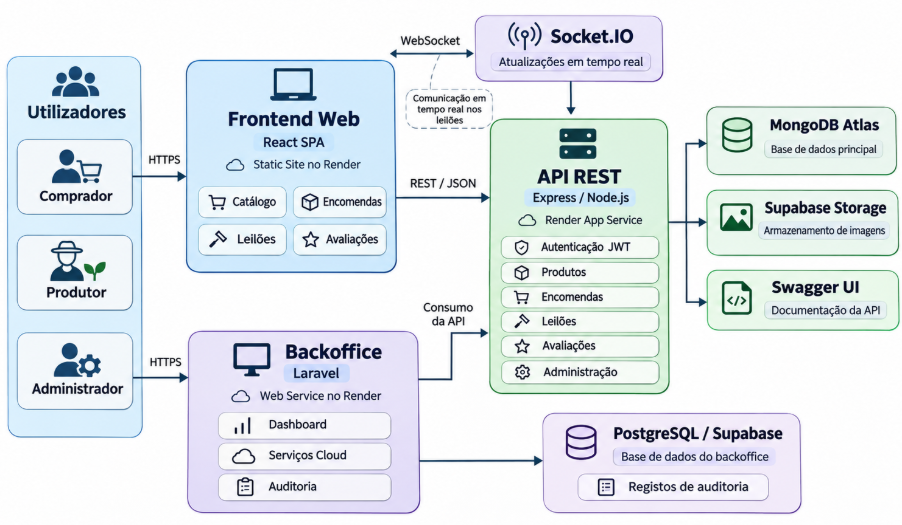

# Do Campo à Mesa

Plataforma web para aproximar **produtores locais** e **consumidores**, permitindo consultar produtos, realizar encomendas e participar em **leilões em tempo real**.

Projeto desenvolvido no âmbito da unidade curricular de **Desenvolvimento Web e para a Cloud**, do Mestrado em Engenharia Informática da ESTG — Universidade Politécnica de Viana do Castelo (2026/2027).

## Aceder à aplicação

| Serviço | Endereço |
| --- | --- |
| Aplicação web | [Do Campo à Mesa](https://do-campo-a-mesa.onrender.com) |
| API REST | [API Express](https://do-campo-a-mesa-api.onrender.com) |
| Documentação da API | [Swagger UI](https://do-campo-a-mesa-api.onrender.com/api-docs/) |
| Backoffice técnico | [Laravel](https://do-campo-a-mesa-backoffice.onrender.com) |

Os serviços publicados em planos gratuitos podem demorar a responder no primeiro acesso devido à suspensão por inatividade.

## Funcionalidades

- **Visitantes e compradores:** catálogo, pesquisa e filtros, páginas de produtores, carrinho, encomendas, acompanhamento de estados e avaliações.
- **Produtores:** gestão de produtos, preços, stock e imagens; acompanhamento de encomendas; criação e acompanhamento de leilões.
- **Administradores:** validação de produtores, moderação de avaliações e consulta de informação administrativa.
- **Leilões em tempo real:** licitações validadas no servidor e atualizações distribuídas por Socket.IO aos participantes.
- **Backoffice Laravel:** consulta de estatísticas, monitorização das integrações cloud e histórico de auditoria.

## Arquitetura e tecnologias



| Componente | Tecnologias | Responsabilidade |
| --- | --- | --- |
| `web/` | React, Vite, Bootstrap 5, SASS | Interface SPA e navegação por perfil |
| `api/` | Node.js, Express, Mongoose | API REST, autenticação, regras de negócio e Socket.IO |
| Base de dados | MongoDB Atlas | Dados de utilizadores, produtos, encomendas e leilões |
| Imagens | Supabase Storage | Armazenamento externo das fotografias |
| `backoffice/` | Laravel, Blade, Eloquent, Docker | Monitorização técnica e auditoria |
| Auditoria | Supabase PostgreSQL | Persistência dos registos do backoffice |
| Publicação | Render | Alojamento do frontend, API e backoffice |

O frontend e o backoffice comunicam com a **mesma API Express**. O Laravel não duplica a gestão de negócio da SPA: utiliza Eloquent para guardar eventos técnicos numa base PostgreSQL separada.

## Executar localmente

**Pré-requisitos:** Node.js e npm, MongoDB ou acesso ao MongoDB Atlas; para o backoffice, PHP e Composer.

### 1. API

Cria `api/.env` a partir do ficheiro de exemplo disponível no projeto e configura a ligação ao MongoDB, o segredo JWT e as credenciais dos serviços utilizados. Não publiques os ficheiros `.env`.

```bash
cd api
npm install
npm run dev
```

API: `http://localhost:3000` · Swagger: `http://localhost:3000/api-docs/`

### 2. Frontend

Configura `web/.env` para apontar à API local.

```bash
cd web
npm install
npm run dev
```

Frontend Vite: `http://localhost:5173`

### 3. Backoffice (opcional)

Prepara `backoffice/.env` com base no ficheiro de exemplo. Para execução local, configura a API em `http://localhost:3000/api` e a base SQLite do Laravel.

```bash
cd backoffice
composer install
php artisan key:generate
php artisan migrate
php artisan serve --port=8000
```

Backoffice: `http://127.0.0.1:8000`. O login administrativo depende de a API Express estar acessível.

## Documentação

- **[Relatório técnico](docs/relatorio.md):** arquitetura, modelação MongoDB, API, consistência das licitações, segurança, cloud, testes, limitações e valorização Laravel.
- **[Especificação OpenAPI](api/openapi.yaml):** endpoints e contratos da API.
- **[Documentação interativa](https://do-campo-a-mesa-api.onrender.com/api-docs/):** Swagger UI.

## Limitações conhecidas

A gestão do stock das encomendas e a atualização das licitações recorrem a operações atómicas sobre documentos individuais, mas não a transações multidocumento. Os lotes vendidos através de leilões **não atualizam automaticamente o stock do produto associado**. Estas limitações, bem como a suspensão por inatividade dos serviços gratuitos, são discutidas no relatório.

## Desenvolvimento e ferramentas

Projeto desenvolvido com Git e GitHub. O **ChatGPT** foi utilizado como assistente no esclarecimento de dúvidas, diagnóstico de erros, revisão de código, apoio ao deployment e documentação. As funcionalidades foram verificadas através de testes locais e na versão publicada.
