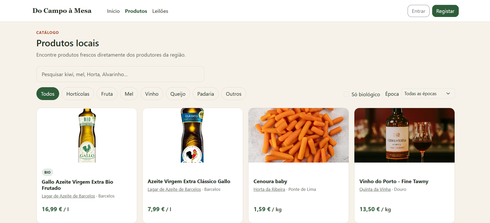
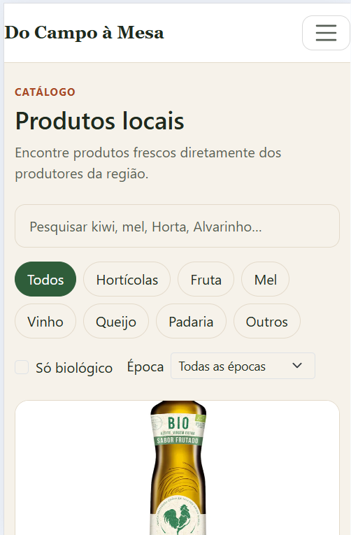
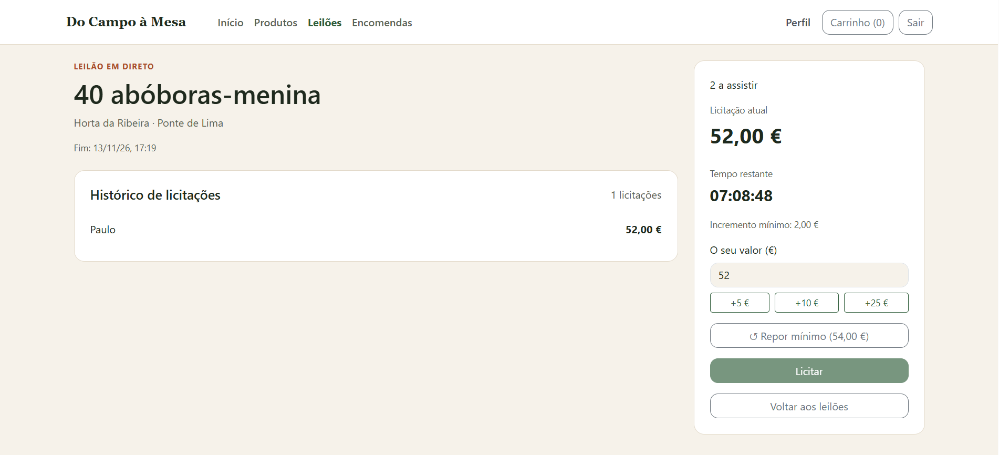
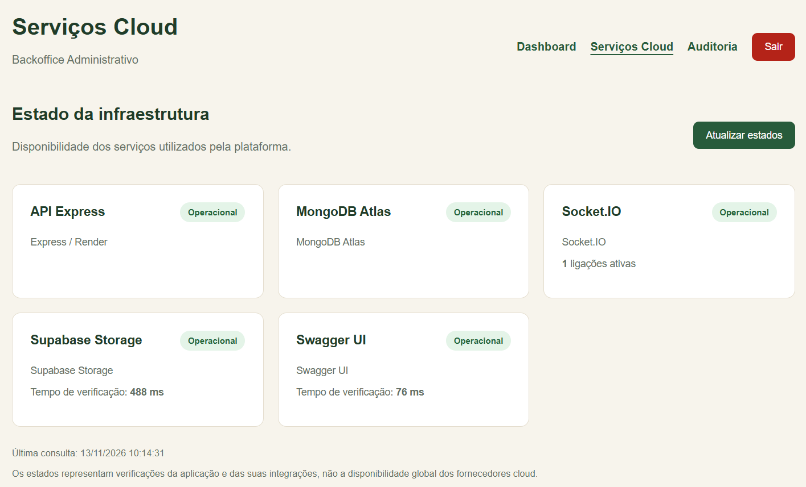
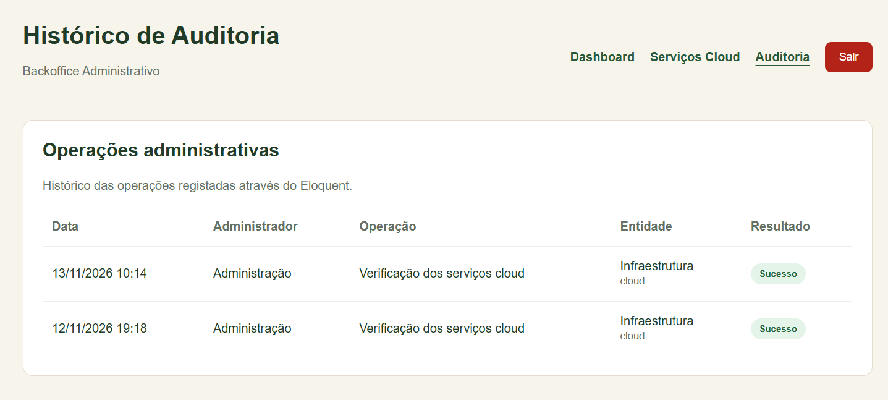

# Do Campo à Mesa

**Relatório final**  


**Mestrado em Engenharia Informática**  
**ESTG, Universidade Politécnica de Viana do Castelo**  
**Ano letivo 2026/2027**


## Índice

1. [Resumo e objetivos](#1-resumo-e-objetivos)
2. [Funcionalidades da aplicação](#2-funcionalidades-da-aplicação)
3. [Arquitetura e tecnologias](#3-arquitetura-e-tecnologias)
4. [Implementação da aplicação React](#4-implementação-da-aplicação-react)
5. [API REST, MongoDB e operações de negócio](#5-api-rest-mongodb-e-operações-de-negócio)
6. [Leilões em tempo real](#6-leilões-em-tempo-real)
7. [Autenticação e segurança](#7-autenticação-e-segurança)
8. [Backoffice técnico em Laravel](#8-backoffice-técnico-em-laravel)
9. [Infraestrutura e publicação na cloud](#9-infraestrutura-e-publicação-na-cloud)
10. [Testes e validação](#10-testes-e-validação)
11. [Limitações e melhorias futuras](#11-limitações-e-melhorias-futuras)
12. [Execução local](#12-execução-local)
13. [Estrutura do repositório](#13-estrutura-do-repositório)
14. [Conclusão](#14-conclusão)
15. [Tecnologias, ferramentas e referências](#15-tecnologias-ferramentas-e-referências)

---

## 1. Resumo e objetivos

O **Do Campo à Mesa** é uma plataforma web orientada à comercialização de produtos de produtores locais, com funcionalidades como catálogo, carrinho de compras, encomendas e leilões em tempo real. A plataforma prevê diferentes perfis de utilização como visitante, comprador, produtor e administrador, com interfaces e permissões adequadas a cada papel.

O objetivo do trabalho foi evoluir o código base fornecido para uma aplicação funcional, integrando alguns dos conteúdos lecionados nas aulas de Desenvolvimento Web e para a Cloud: **frontend responsivo**, **Single Page Application (SPA)**, **API REST**, **persistência NoSQL**, **autenticação e autorização**, **WebSockets**, **documentação OpenAPI** e **publicação na cloud**.

Como extensão ao trabalho principal, foi desenvolvido um **backoffice técnico em Laravel**, independente do painel administrativo da aplicação React. Este módulo utiliza **MVC, Blade e Eloquent** para apresentar estatísticas, monitorizar serviços e guardar um histórico de auditoria numa base PostgreSQL.

### 1.1. Âmbito

O trabalho inclui três componentes executáveis:

- **`web/` : aplicação principal:** interface React para as funcionalidades de negócio.
- **`api/` : servidor:** API Express, regras de negócio, MongoDB e comunicação Socket.IO.
- **`backoffice/` : módulo adicional:** aplicação Laravel para monitorização técnica e auditoria.

A aplicação React e o backoffice são clientes distintos da mesma API Express. A principal fonte de dados de negócio é o **MongoDB Atlas**. A auditoria técnica do Laravel é guardada separadamente em **PostgreSQL no Supabase**.

## 2. Funcionalidades da aplicação

### 2.1. Visitante e comprador

Na área pública, o visitante pode consultar o catálogo, pesquisar produtos, aplicar filtros por categoria, época e preço, e visitar páginas de produtores. O comprador autenticado pode adicionar produtos ao carrinho, concluir encomendas com opção de levantamento ou entrega, consultar os respetivos estados, participar em leilões e avaliar produtos ou produtores após a entrega. As funcionalidades são apresentadas através de páginas React e operações na API.

### 2.2. Produtor

O produtor dispõe de um painel onde gere o catálogo, incluindo preços, stock e fotografias, acompanha encomendas e cria ou acompanha leilões. O backend verifica se o produtor está validado para as operações protegidas. O projeto inclui ainda apresentação de indicadores e avisos de stock baixo.

### 2.3. Leilões

Nos leilões, os compradores entram numa sala Socket.IO, consultam o preço atual, o histórico recente e a contagem decrescente, e enviam licitações que o servidor valida. As alterações aceites são difundidas aos participantes da mesma sala. O servidor mantém a hora de término do leilão.

### 2.4. Administrador da aplicação principal

O painel administrativo da SPA permite aprovar ou rejeitar o registo de produtores, moderar avaliações denunciadas e consultar estatísticas e leilões ativos.

### 2.5. Backoffice técnico adicional

O Laravel disponibiliza três páginas protegidas:

| Página | Responsabilidade |
| --- | --- |
| **Dashboard** | Consultar estatísticas da plataforma obtidas da API Express. |
| **Serviços Cloud** | Verificar o estado da API, MongoDB, Socket.IO, Supabase Storage e Swagger UI. |
| **Auditoria** | Consultar operações técnicas registadas com Eloquent no PostgreSQL. |

## 3. Arquitetura e tecnologias

### 3.1. Visão geral

 
 
*Figura 1 - Componentes e serviços cloud utilizados no projeto.*

### 3.2. Tecnologias utilizadas

| Camada | Tecnologias | Utilização |
| --- | --- | --- |
| Frontend | React, Vite, Bootstrap 5, SASS | SPA, componentes, navegação e interface responsiva. |
| Backend | Node.js, Express | Endpoints REST, autenticação e regras de negócio. |
| Persistência principal | MongoDB, Mongoose, MongoDB Atlas | Entidades e operações do marketplace. |
| Tempo real | Socket.IO | Comunicação e atualização de leilões. |
| Documentação da API | OpenAPI, Swagger UI | Especificação e exploração dos endpoints. |
| Imagens | Supabase Storage | Armazenamento externo dos ficheiros enviados. |
| Backoffice | Laravel, Blade, Eloquent | MVC, monitorização e auditoria técnica. |
| Auditoria em produção | PostgreSQL do Supabase | Persistência separada para registos técnicos. |
| Alojamento | Docker, Apache, Render | Construção e publicação do Laravel; alojamento web e API. |
| Versionamento | Git e GitHub | Controlo de versões e disponibilização do código. |

### 3.3. Decisões de arquitetura

A separação entre React e Express permite uma interface independente da implementação das regras de negócio. O backend centraliza a validação de permissões e o acesso à base de dados. O Socket.IO partilha o servidor HTTP com o Express, permitindo comunicação bidirecional nos leilões.

No backoffice, optou-se por **consumir a API Express**, em vez de duplicar os modelos de negócio em Laravel. O Eloquent é utilizado para um propósito distinto: guardar eventos de auditoria numa base de dados relacional. Esta escolha permite demonstrar integração entre tecnologias e evita sobreposição entre painéis administrativos.

## 4. Implementação da aplicação React

A aplicação principal está implementada como **SPA (Single Page Application)** com React e Vite. A navegação entre páginas é realizada no cliente e as operações de negócio comunicam com a API Express.

A interface foi construída com uma abordagem **Mobile First**. Nos ficheiros `_variables.scss` e `_mixins.scss` estão definidos os pontos de quebra **768 px, 1024 px e 1280 px** e um mixin `a-partir-de()` usado nos estilos. O catálogo passa de uma coluna em ecrãs pequenos para duas, três e quatro colunas nos breakpoints respetivos. O Bootstrap é usado para grelhas, cartões, formulários e navegação; os parciais SASS permitem manter estilos consistentes.

A organização do frontend inclui:

- **Rotas e páginas:** organização por funcionalidades e perfis de utilizador.
- **Componentes reutilizáveis:** elementos como navegação, cartões de produto e componentes de apresentação de estados.
- **Contextos React:** partilha do estado de autenticação e do carrinho entre componentes.
- **Hooks específicos:** integração com funcionalidades de leilão e notificações.
- **SASS e Bootstrap 5:** estrutura de estilos reutilizável e adaptação a diferentes dimensões de ecrã.

A comunicação HTTP encontra-se centralizada no cliente da API, permitindo incluir o token de autenticação nas operações protegidas. Os caminhos visíveis e as ações disponíveis dependem do papel do utilizador.

No catálogo, foram incluídos mecanismos de pesquisa, categorias e filtragem de produtos biológicos. O projeto partiu de uma versão com dados simulados, posteriormente integrada com os dados disponibilizados pelo backend.

  
  
 
*Figuras 2 e 3 - Adaptação do catálogo a diferentes dimensões de ecrã.*

## 5. API REST, MongoDB e operações de negócio

### 5.1. Organização do backend

O servidor Node.js utiliza **Express** para disponibilizar os endpoints da plataforma. O código está organizado em rotas, modelos, middleware, serviços e componentes Socket.IO.

Entre os recursos representados na API incluem-se:

| Recurso | Finalidade |
| --- | --- |
| `auth` | Registo, login e identificação do utilizador. |
| `products` | Consulta e gestão de produtos. |
| `producers` | Operações associadas aos produtores. |
| `orders` | Criação e acompanhamento de encomendas. |
| `auctions` | Leilões e respetivas operações. |
| `reviews` | Avaliações e moderação. |
| `admin` | Estatísticas e operações administrativas protegidas. |

A documentação OpenAPI está definida em `api/openapi.yaml` e é apresentada através do Swagger UI.

### 5.2. Persistência MongoDB

A base de dados principal utiliza **MongoDB Atlas**, com acesso através de modelos Mongoose. O código base definiu entidades como `User`, `Product`, `Order`, `Auction`, `Bid` e `Review`, posteriormente utilizadas na implementação dos fluxos da aplicação.

A adoção de MongoDB permite representar documentos associados às entidades do marketplace. As relações e a consistência entre documentos exigem, contudo, cuidados próprios nas operações que afetam mais do que uma coleção.

### 5.2.1. Critérios de modelação: embedding e referencing

No MongoDB, a decisão entre **embedding** (incorporar dados no mesmo documento) e **referencing** (guardar identificadores que apontam para outros documentos) depende dos padrões de leitura e escrita, da cardinalidade e do ciclo de vida dos dados. 

| Critério | Embedding | Referencing |
| --- | --- | --- |
| Consulta habitual | Dados consultados em conjunto | Entidades consultadas autonomamente |
| Cardinalidade | Subconjuntos pequenos e limitados | Relações potencialmente extensas ou crescentes |
| Atualizações | Dados que mudam com o documento principal | Entidades partilhadas ou atualizadas separadamente |
| Consistência | Atualização atómica do próprio documento | Pode exigir operações entre documentos |
| Duplicação | Aceita duplicação controlada | Evita cópias de entidades independentes |

**Aplicação ao domínio:** produtos e produtores têm ciclos de vida distintos. Leilões e licitações apresentam uma relação cujo número de elementos pode crescer enquanto encomendas precisam de preservar informação comercial relativa ao momento da compra. Estes fatores motivam a análise de referências para entidades independentes e de incorporação de pequenos conjuntos ou *snapshots* quando relevante. **Confirmação no código (`api/src/models/`):** as decisões anteriores distribuem-se da seguinte forma:

| Modelo | Implementação | Motivo da escolha |
| --- | --- | --- |
| `User` | Subdocumento `produtor` com dados da exploração e validação | Relação 1:1, normalmente consultada com o perfil; o embedding evita uma coleção extra. |
| `Product` | Campo `produtor` com `ObjectId` e `ref: 'User'` | Um produtor tem vários produtos, que podem ser alterados e consultados separadamente. |
| `Order` | Array `linhas[]` incorporado, com nome, preço unitário e quantidade; `comprador`, `produtor` e produto referenciados | As linhas acompanham a encomenda e guardam os valores do momento da compra; as referências mantêm ligação às entidades originais. |
| `Auction` | `licitacaoAtual` incorporada e referências ao produtor/produto | Permite ler rapidamente o estado atual sem percorrer todo o histórico. |
| `Bid` | Documento próprio com referências ao leilão e comprador | O histórico cresce a cada licitação; separá-lo evita crescimento contínuo de um único documento de leilão. |
| `Review` | Avaliação independente com referências ao autor, produtor, produto e encomenda | Possibilita pesquisa, denúncia e moderação de cada avaliação, sem incorporar uma lista crescente no produtor. |

Foram definidos índices que acompanham os padrões de consulta, incluindo `User.email` único, índices de pesquisa e filtragem em `Product`, e índices únicos parciais em `Order` e `Review`.

### 5.3. Gestão de imagens

O backend integra o **Supabase Storage** para armazenar imagens enviadas pela aplicação. A lógica de armazenamento é tratada por um serviço do backend (`api/src/services/imagens.js`), evitando expor credenciais de acesso ao armazenamento no frontend.

### 5.4. Consistência dos dados

**Leilões:** a atualização do preço de um leilão utiliza `findOneAndUpdate` com condições que procuram garantir a atomicidade da alteração do documento e rejeitar licitações concorrentes que não respeitem o incremento mínimo.

A alteração do leilão e a criação do registo da licitação em `Bid` são operações separadas. Uma falha entre as duas poderá produzir inconsistências. A atomicidade sobre o documento `Auction` **não equivale a uma transação multidocumento**.

**Encomendas:** na gestão do stock são utilizadas verificações e atualizações atómicas sobre os produtos, acompanhadas por lógica de compensação quando uma etapa da encomenda falha. Esta abordagem procura reduzir o risco de vender quantidades indisponíveis, mas a atualização de stock e a criação da encomenda não fazem parte de uma transação multidocumento única. Em caso de falha entre operações, a consistência global não está totalmente garantida.


## 6. Leilões em tempo real

O projeto utiliza **Socket.IO** para comunicar eventos associados a leilões entre o servidor e os clientes ligados. O servidor HTTP do Express é partilhado com o Socket.IO; cada ligação é autenticada com JWT e os participantes entram em salas correspondentes aos leilões. O hook React `useLeilao` acompanha o estado na interface.

### 6.1. Validação e consistência das licitações

Quando um comprador envia uma licitação, a validação é feita **no servidor**, não apenas no formulário React. A lógica verifica as condições do leilão, incluindo o seu estado, a hora de término e o incremento mínimo. A alteração do preço é realizada através de `findOneAndUpdate`, com condições de aceitação incluídas na própria operação MongoDB.

Esta decisão é importante nos casos em que dois compradores licitam quase ao mesmo tempo. Por exemplo, se duas licitações do mesmo valor chegarem em simultâneo e esse valor só for válido face ao preço anterior, a primeira atualização que cumprir as condições altera o documento; a segunda será reavaliada face ao novo estado e poderá ser recusada por já não respeitar o incremento. **A atomicidade é garantida na atualização do documento do leilão**, não na escrita conjunta do histórico `Bid`, conforme explicado na secção 5.4.

### 6.2. Sincronização dos participantes

Após uma licitação aceite, o servidor transmite a atualização à sala Socket.IO do respetivo leilão, evitando enviar eventos de um leilão para todos os utilizadores. Os clientes apresentam o novo valor e atualizam a interface com os eventos recebidos. O servidor guarda a hora de término (`terminaEm`), permitindo aos clientes calcular o tempo restante a partir de uma referência comum, sem cada cliente definir autonomamente a duração do leilão.

Foram realizados testes de interação com duas sessões de utilizador para observar a propagação de eventos em tempo real. Não foram efetuados testes de carga ou uma demonstração de auto-scaling.

  
*Figura 3 — Estado do leilão atualizado entre os participantes.*

## 7. Autenticação e segurança

### 7.1. Aplicação principal

A API guarda passwords com **hash bcrypt** e emite **JSON Web Tokens (JWT)** com prazo de validade. A autenticação é centralizada na API Express. As rotas protegidas utilizam middleware que valida o token e restringe as operações segundo o papel do utilizador (`comprador`, `produtor` ou `admin`, conforme a funcionalidade).

A interface React adapta a navegação e as páginas ao papel autenticado, mas a autorização efetiva das operações protegidas pertence ao backend. O token é guardado em `localStorage` para manter a sessão após atualizar a página. Numa evolução futura, seria pertinente avaliar cookies `HttpOnly` com as proteções adequadas. Os dados sensíveis e as credenciais dos serviços cloud são configurados através de variáveis de ambiente.

### 7.2. Backoffice Laravel

O Laravel apresenta um formulário de login próprio, mas **não mantém uma base de utilizadores administrativa independente**. O `AuthController` envia as credenciais ao endpoint de autenticação da API Express e só permite continuar quando a resposta identifica um utilizador com papel `admin`.

Após autenticação, o token da API é guardado na sessão Laravel. O middleware `VerificarAdminApi` confirma a identidade e as permissões através da API antes de autorizar o acesso às páginas protegidas.

Medidas implementadas e verificadas:

- Restrição das páginas a sessões administrativas válidas.
- Rejeição de credenciais de comprador e produtor no login Laravel.
- Proteção CSRF nos formulários de alteração de estado.
- Invalidação da sessão no logout.
- Comunicação HTTPS no formulário de login publicado.
- Configuração de produção com `APP_DEBUG=false` e cookies seguros.
- Tratamento de indisponibilidade da API, sem apresentar detalhes técnicos ao utilizador final.

O Laravel foi configurado para reconhecer o protocolo HTTPS original quando executado atrás do proxy do Render.

## 8. Backoffice técnico em Laravel

### 8.1. Motivação e separação de responsabilidades

O backoffice foi desenvolvido como **funcionalidade adicional** para demonstrar a utilização de **Laravel, MVC, Blade e Eloquent**, integrando-se com a solução principal sem repetir a moderação e gestão de produtores existentes no React.

A estrutura está organizada segundo o padrão MVC:

- **Controllers:** autenticam pedidos, consultam a API e organizam os dados para apresentação.
- **Views Blade:** apresentam o Dashboard, a monitorização, a auditoria e o login.
- **Model Eloquent `RegistoAuditoria`:** representa os eventos administrativos persistidos numa tabela relacional.
- **Middleware:** controla o acesso administrativo a todas as páginas protegidas.

O layout Blade partilhado reúne a navegação e os estilos do backoffice.

### 8.2. Dashboard

O Dashboard consulta o endpoint administrativo de estatísticas da API Express e apresenta valores associados a utilizadores, produtores, encomendas do dia e leilões ativos. Estes valores são obtidos dinamicamente da aplicação principal, não são estatísticas independentes mantidas pelo Laravel.

### 8.3. Monitorização de serviços

A página **Serviços Cloud** apresenta verificações de integração dos seguintes componentes:

| Serviço | Verificação apresentada |
| --- | --- |
| API Express | Resposta do endpoint protegido de monitorização. |
| MongoDB Atlas | Estado da ligação utilizada pela API Express. |
| Socket.IO | Instância ativa e número de ligações observado. |
| Supabase Storage | Verificação de acesso ao armazenamento através do backend. |
| Swagger UI | Resposta do endpoint de documentação da API. |

Estas verificações descrevem o estado das **integrações da aplicação**, e não a disponibilidade global dos fornecedores cloud.

O botão **Atualizar estados** efetua uma nova consulta e cria um registo de auditoria; a simples visualização da página não adiciona automaticamente um evento.


*Figura 4 - Monitorização das cinco integrações no Backoffice Laravel.*

### 8.4. Auditoria com Eloquent

Quando o administrador solicita manualmente a atualização da monitorização, o Laravel cria um `RegistoAuditoria` com os campos de identificação do administrador, ação, entidade, resultado e datas de criação/atualização.

Os resultados são classificados como `sucesso`, `parcial` ou `falha`, consoante o número de verificações operacionais obtidas. A página Auditoria consulta e apresenta os registos por ordem temporal decrescente.

No desenvolvimento local, o Eloquent utiliza **SQLite**. Em produção, utiliza o **PostgreSQL do Supabase**, no esquema `backoffice`, de forma a preservar a auditoria mesmo quando o Render substitui o contentor Docker.

A migração estrutural é realizada através das **migrations** do Laravel. Os registos anteriores guardados apenas no SQLite local não foram migrados automaticamente para o PostgreSQL.

  
*Figura 5 - Registo técnico persistido no PostgreSQL do Supabase.*

### 8.5. Processo de publicação

O `backoffice/Dockerfile` prepara um contentor com PHP, Apache, extensões PostgreSQL e Composer. O Apache serve a pasta `public` do Laravel. Durante o arranque do serviço, é executado `php artisan migrate --force` antes de iniciar o Apache.

A configuração de produção é fornecida por variáveis de ambiente no Render, sem publicar passwords, chaves de aplicação ou ficheiros `.env` no repositório.

## 9. Infraestrutura e publicação na cloud

### 9.1. Serviços utilizados

| Componente | Plataforma | Endereço público |
| --- | --- | --- |
| Aplicação React | Render Static Site | https://do-campo-a-mesa.onrender.com |
| API Express | Render Web Service | https://do-campo-a-mesa-api.onrender.com |
| Swagger UI | API Express / Render | https://do-campo-a-mesa-api.onrender.com/api-docs/ |
| Backoffice Laravel | Render Docker Web Service | https://do-campo-a-mesa-backoffice.onrender.com |
| Base de dados de negócio | MongoDB Atlas | Acesso privado, sem URL pública de consulta. |
| Imagens | Supabase Storage | Acesso configurado na API. |
| Auditoria | Supabase PostgreSQL | Esquema `backoffice`. |

### 9.1.1. Classificação dos modelos de serviço cloud e justificação

| Componente | Modelo | Justificação da opção |
| --- | --- | --- |
| React alojado no Render Static Site | **PaaS** (alojamento gerido de site estático) | Build, distribuição, HTTPS e publicação sem gestão direta de servidores. |
| Express e Laravel no Render Web Service | **PaaS** | Execução e publicação geridas pela plataforma; a equipa gere código, Docker e configuração, não as máquinas virtuais. |
| MongoDB Atlas | **DBaaS** (serviço gerido de base de dados) | Gestão da infraestrutura MongoDB, ligação remota e redução da manutenção operacional. |
| Supabase Storage | **BaaS** (componente gerido de backend) | Armazenamento de objetos e integração através de API/SDK, sem administrar um servidor de ficheiros. |
| Supabase PostgreSQL | **DBaaS**, no ecossistema Supabase | Base relacional gerida, utilizada pelo Eloquent para persistir a auditoria fora do contentor Laravel. |
| Docker | **Tecnologia de contentorização**, não IaaS/PaaS/BaaS | Assegura um ambiente de execução reproduzível para o backoffice. |

**IaaS vs. PaaS:** não foi contratada nem administrada uma máquina virtual IaaS. Uma alternativa IaaS exigiria configurar sistema operativo, servidor web, atualizações, certificados, backups e monitorização. A escolha de PaaS/serviços geridos reduz esse esforço e facilitou o deploy no contexto do trabalho académico, em troca de limites dos planos e dependência dos fornecedores.

**Nota:** BaaS e DBaaS são classificações de serviços geridos complementares aos serviços IaaS/PaaS/SaaS, não se devem apresentar como categorias mutuamente exclusivas.

### 9.2. Separação entre ambientes

O desenvolvimento utiliza endereços locais para React, Express e Laravel. A publicação usa URLs HTTPS e variáveis de ambiente específicas de cada serviço.

A API Express faz a ligação ao MongoDB Atlas e ao Supabase Storage. O Laravel em produção consulta a API Express publicada e utiliza uma ligação PostgreSQL própria para a auditoria. As credenciais permanecem fora do Git e são configuradas nos ambientes de execução.

### 9.3. Considerações sobre o Render gratuito

Os serviços gratuitos podem entrar em suspensão por inatividade, aumentando o tempo da primeira resposta. O armazenamento local de um contentor não deve ser usado como fonte de persistência definitiva, por isso, os registos de auditoria são mantidos no Supabase PostgreSQL.

### 9.4. Elasticidade, escalabilidade e custos

**Elasticidade** é a capacidade de aumentar ou reduzir recursos em função da procura. **Escalabilidade** é a capacidade de suportar mais carga recorrendo a mais recursos ou a uma arquitetura diferente. A aplicação foi publicada e testada funcionalmente, mas **não foram executados testes de carga nem demonstrado autoscaling**. 

Na configuração utilizada, os dois serviços dinâmicos Render (Express e Laravel) correm em instâncias gratuitas, sem escalonamento horizontal. A API Express mantém também ligações Socket.IO, cujo crescimento implica considerar memória, número de ligações simultâneas e, no caso de múltiplas instâncias, um mecanismo partilhado para distribuição de eventos e salas. As bases geridas Atlas e Supabase podem oferecer evoluções de capacidade conforme o plano, mas isso não significa que tenham escalado automaticamente nos testes efetuados.

**Limites dos planos gratuitos:** o Render descreve a suspensão de Web Services Free por inatividade, um orçamento mensal de horas gratuitas partilhadas e armazenamento local efémero. Com Express e Laravel em serviços separados, é importante verificar esse orçamento no dashboard do workspace. O Supabase Free inclui **500 MB de PostgreSQL**, **1 GB de Storage** e pode suspender projetos após uma semana de inatividade. 

**Análise CapEx vs. OpEx:** numa alternativa alojada em infraestrutura própria, seria necessário investir inicialmente em servidores, armazenamento, rede e equipamento de segurança (**CapEx: despesa de capital**), além de suportar eletricidade, manutenção e administração. Com Render, MongoDB Atlas e Supabase, o investimento inicial em hardware é evitado e os custos potenciais passam a ser predominantemente recorrentes, associados aos recursos contratados (**OpEx: despesa operacional**).

**Fontes para consulta das condições e preços (verificar valores na data da entrega):**
- Render, documentação dos serviços gratuitos: https://render.com/docs/free
- Render, preçário: https://render.com/pricing
- Supabase, preçário: https://supabase.com/pricing
- MongoDB Atlas, limites do cluster gratuito: https://www.mongodb.com/docs/atlas/reference/free-shared-limitations/

## 10. Testes e validação

A validação combinou execução local, testes manuais das funcionalidades e verificações diretamente nos serviços cloud publicados.

### 10.1. Testes funcionais da aplicação principal

A validação funcional foi realizada durante o desenvolvimento e integração da SPA com a API. Entre os cenários exercitados estiveram os seguintes:

| Cenário | Verificação realizada |
| --- | --- |
| Autenticação e perfis | Utilização da aplicação com diferentes perfis e verificação das áreas disponíveis. |
| Catálogo | Pesquisa, filtragem e consulta de produtos e produtores. |
| Gestão de produtos | Utilização das operações de catálogo do produtor e envio de fotografias para o armazenamento cloud. |
| Encomendas | Criação e acompanhamento de encomendas e atualização dos respetivos estados. |
| Administração | Validação de produtores e moderação de avaliações no painel React. |
| Leilões em tempo real | Acompanhamento do mesmo leilão em sessões distintas e verificação da atualização por Socket.IO. |

Estes cenários correspondem a verificações funcionais realizadas ao longo do desenvolvimento. Não representam uma bateria exaustiva de testes automatizados, nem devem ser confundidos com ensaios de carga ou de concorrência em larga escala.

### 10.2. Testes do Backoffice Laravel

| Cenário | Resultado observado |
| --- | --- |
| Acesso ao Dashboard sem autenticação | Redirecionamento para login. |
| Acesso a Serviços Cloud sem autenticação | Redirecionamento para login. |
| Acesso à Auditoria sem autenticação | Redirecionamento para login. |
| Pedido POST sem token CSRF | Resposta HTTP `419`, operação rejeitada. |
| Login com perfil comprador ou produtor | Acesso recusado. |
| Login com administrador | Acesso autorizado. |
| Logout e acesso direto a página protegida | Sessão invalidada; novo login necessário. |
| API Express indisponível no desenvolvimento | Falha tratada pela aplicação Laravel. |
| Construção da imagem Docker | `docker build` concluído com sucesso. |
| Login no Backoffice publicado | Realizado com sucesso após correção do reconhecimento de HTTPS. |
| Monitorização online | Cinco componentes apresentados como operacionais no teste realizado. |
| Registo de auditoria | Evento `verificar_servicos` criado e consultável no PostgreSQL. |
| Novo deploy do Backoffice | Registo anterior preservado após o deploy. |

A expiração natural de um JWT **não foi validada num teste específico** nesta fase.

### 10.3. Evidência de integração

Durante os testes, a página de monitorização apresentou a API Express, o MongoDB Atlas, o Socket.IO, o Supabase Storage e o Swagger UI como operacionais. Foi ainda consultada diretamente, no Supabase, a tabela de auditoria criada pelas migrations e o registo produzido a partir do Backoffice online.

Os testes realizados evidenciam os cenários descritos, mas não constituem uma auditoria de segurança exaustiva nem garantem disponibilidade permanente dos serviços externos.

## 11. Limitações e melhorias futuras

### 11.1. Consistência de operações MongoDB

Tal como descrito na secção 5.4, há operações que alteram vários documentos sem uma transação global. Uma evolução futura passará pela implementação e teste de transações multidocumento, especialmente em licitações e encomendas, de acordo com as capacidades e configuração do cluster MongoDB.

### 11.2. Disponibilidade dos serviços gratuitos

A suspensão por inatividade no Render pode provocar atrasos no primeiro acesso. A monitorização implementada permite verificar integrações, mas não constitui uma plataforma de observabilidade permanente com alertas externos e métricas históricas.

### 11.3. Sessões e operação do Laravel

O Backoffice utiliza sessões em ficheiro no contentor. Um reinício ou substituição do contentor pode terminar sessões ativas, exigindo novo login. Isto **não afeta os dados de auditoria**, guardados externamente no PostgreSQL.

### 11.4. Melhorias adicionais

Evoluções possíveis incluem testes automatizados adicionais, validação controlada da expiração de JWT, monitorização com alertas, análise de desempenho e reforço de controlos de segurança para a publicação definitiva.

## 12. Execução local

### 12.1. Pré-requisitos

- Node.js e npm compatíveis com as dependências do projeto.
- PHP e Composer compatíveis com o Laravel instalado.
- Acesso a uma instância MongoDB ou MongoDB Atlas para a API.
- Configuração das credenciais necessárias para os serviços externos que se pretenda utilizar.


### 12.2. API Express

A partir da raiz do repositório, preparar primeiro `api/.env` com base em `api/.env.example` sem copiar credenciais reais para o Git. Confirmar a ligação ao MongoDB, `JWT_SECRET` e as variáveis dos serviços usados na instalação.

Depois, executar:

```bash
cd api
npm install
npm run dev
```

Por predefinição, o servidor foi utilizado localmente em `http://localhost:3000` e o Swagger UI em `http://localhost:3000/api-docs/`.

### 12.3. Aplicação React

Num segundo terminal, a partir da raiz do repositório, preparar `web/.env` com as variáveis necessárias para apontar ao backend local, utilizando o ficheiro de exemplo disponível no projeto.

Depois, executar:

```bash
cd web
npm install
npm run dev
```

Configurar o `.env` do frontend para comunicar com a API local. Durante o desenvolvimento, o Vite foi executado em `http://localhost:5173`.

### 12.4. Backoffice Laravel

Num terceiro terminal, instalar as dependências e **criar primeiro o ficheiro `backoffice/.env`** a partir de `.env.example`, adaptando-o à instalação. Configurar `API_BASE_URL=http://localhost:3000/api`, a ligação SQLite e as restantes opções locais. No desenvolvimento realizado, a auditoria utilizou o ficheiro `backoffice/database/database.sqlite`, que deve existir antes de correr as migrations.

```bash
cd backoffice
composer install
# Preparar .env a partir de .env.example antes do comando seguinte
php artisan key:generate
php artisan migrate
php artisan serve --port=8000
```

O backoffice fica disponível em `http://127.0.0.1:8000`. É necessário que a API esteja acessível para validar o login administrativo.

### 12.5. Docker do Backoffice

Para testar apenas a construção da imagem:

```bash
cd backoffice
docker build -t do-campo-a-mesa-backoffice .
```

A execução do contentor requer variáveis de ambiente de produção ou de teste apropriadas para a API, `APP_KEY` e a base de dados.


## 13. Estrutura do repositório

```text
do-campo-a-mesa/
├── api/
│   ├── openapi.yaml          # Especificação da API
│   ├── src/
│   │   ├── server.js         # HTTP e Socket.IO
│   │   ├── app.js            # Configuração do Express
│   │   ├── models/           # Modelos Mongoose
│   │   ├── routes/           # Rotas REST
│   │   ├── middleware/       # Autenticação e erros
│   │   ├── sockets/          # Eventos e salas em tempo real
│   │   └── services/         # Integrações, incluindo imagens
│   └── package.json
├── web/
│   ├── src/
│   │   ├── components/       # Componentes React
│   │   ├── context/          # Estados partilhados
│   │   ├── hooks/            # Lógica reutilizável
│   │   ├── pages/            # Páginas da SPA
│   │   └── styles/           # SASS
│   └── package.json
├── backoffice/
│   ├── app/Http/Controllers/ # Controllers Laravel
│   ├── app/Http/Middleware/  # Controlo de acesso
│   ├── app/Models/           # RegistoAuditoria (Eloquent)
│   ├── resources/views/      # Templates Blade
│   ├── database/migrations/  # Estrutura relacional
│   ├── routes/web.php        # Rotas do backoffice
│   ├── Dockerfile            # Ambiente de produção
│   └── .dockerignore
├── docs/                     # Documentação complementar
└── README.md                 # Relatório e guia do projeto
```

## 14. Conclusão

O desenvolvimento do **Do Campo à Mesa** permitiu integrar várias tecnologias e conceitos da unidade curricular num projeto com uma arquitetura distribuída. A aplicação principal combina uma SPA React, uma API REST Express e persistência MongoDB, incorporando ainda comunicação em tempo real com Socket.IO e armazenamento de imagens na cloud.

A disponibilização dos serviços no Render, com MongoDB Atlas e Supabase, permitiu testar a aplicação num contexto próximo da utilização real, incluindo autenticação e comunicação entre componentes alojados separadamente.

O **Backoffice Laravel** acrescentou uma vertente técnica distinta da administração de negócio: consulta de estatísticas, monitorização de integrações e auditoria persistente através de Eloquent e PostgreSQL. Os testes em produção confirmaram a gravação de um evento de auditoria e a sua preservação após um novo deploy.

Permanecem limitações reconhecidas, particularmente no tratamento de operações MongoDB que envolvem múltiplos documentos e na disponibilidade dos serviços gratuitos. 

## 15. Tecnologias, ferramentas e referências

### Documentação técnica

- [React](https://react.dev/)
- [Vite](https://vite.dev/)
- [Bootstrap](https://getbootstrap.com/)
- [Express](https://expressjs.com/)
- [MongoDB](https://www.mongodb.com/docs/)
- [Mongoose](https://mongoosejs.com/docs/)
- [Socket.IO](https://socket.io/docs/v4/)
- [OpenAPI](https://spec.openapis.org/oas/latest.html)
- [Laravel](https://laravel.com/docs)
- [Supabase](https://supabase.com/docs)
- [Render](https://render.com/docs)
- [Docker](https://docs.docker.com/)

### Processo de desenvolvimento

O projeto foi desenvolvido com versionamento Git/GitHub, testes locais e verificações nos serviços publicados. Foi utilizado o **ChatGPT como assistente de IA**, nomeadamente para apoio na interpretação de erros, revisão de código, configuração do deploy e revisão do relatório e do powerpoint.

