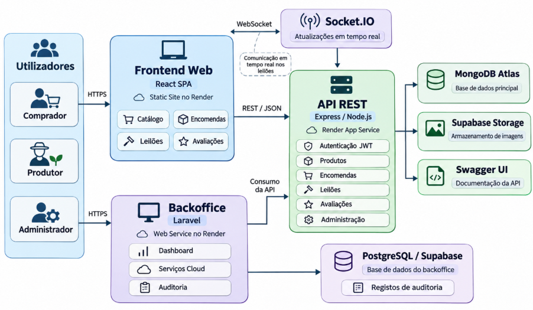
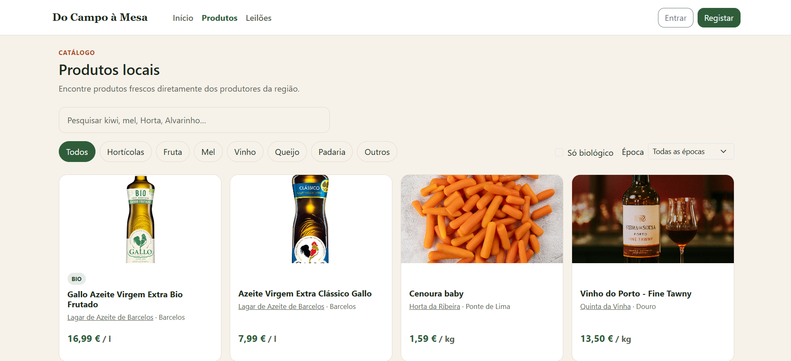
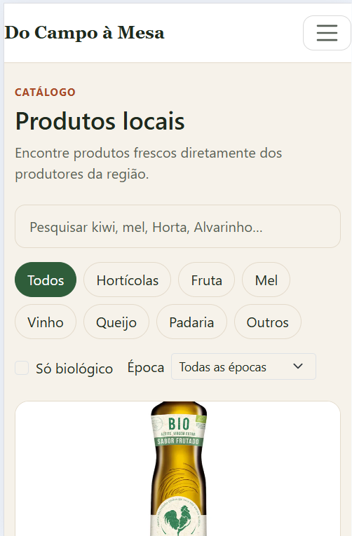
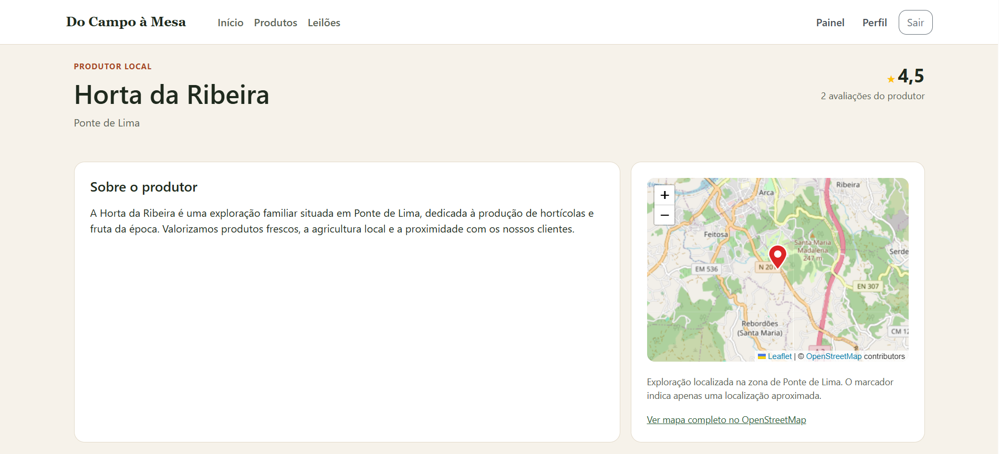
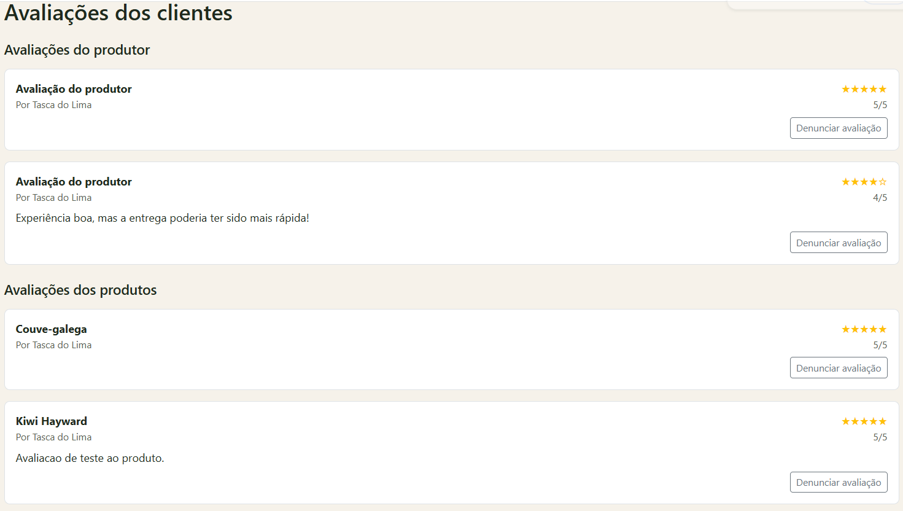
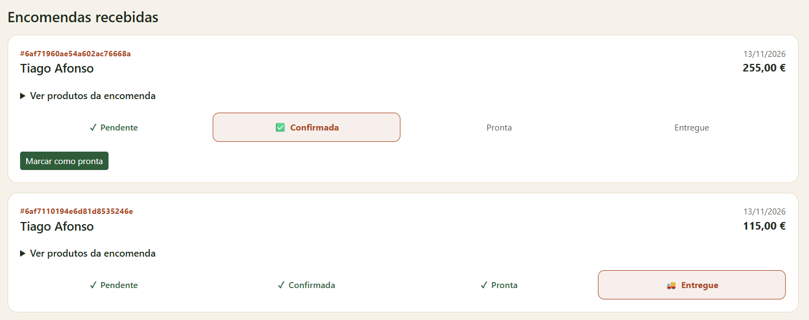
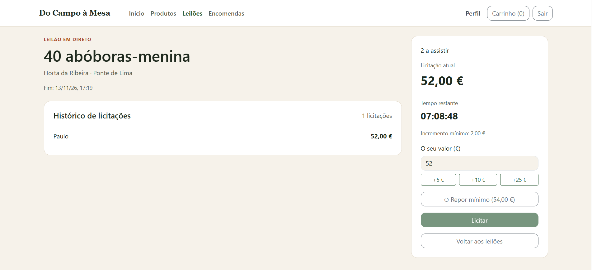
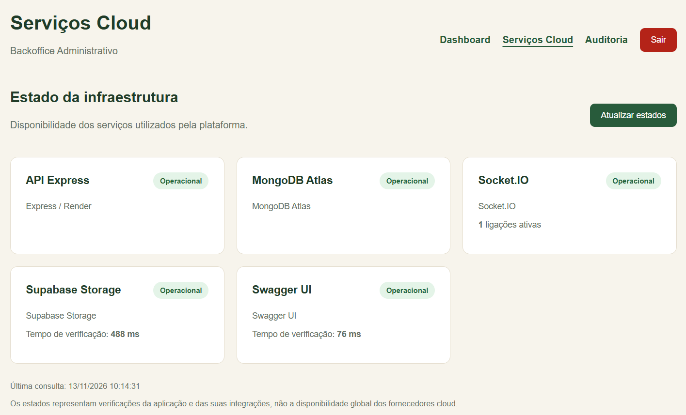
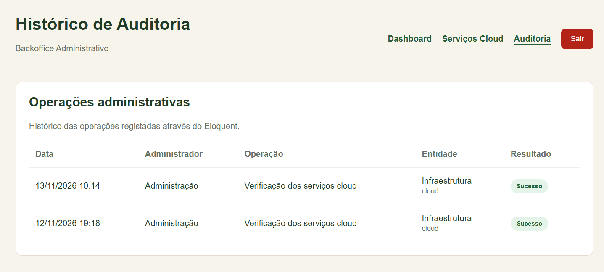

# Relatório — Do Campo à Mesa

**Trabalho Prático de Desenvolvimento Web e para a Cloud**  
Mestrado em Engenharia Informática · ESTG - Universidade Politécnica de Viana do Castelo  
Ano letivo 2026/2027

## 1. Introdução

O **Do Campo à Mesa** é uma plataforma web que aproxima produtores locais de consumidores. O projeto inclui um catálogo de produtos, páginas de produtores, carrinho, encomendas, avaliações e leilões em tempo real. Existem quatro tipos de utilização: visitante, comprador, produtor e administrador, cada um com acesso às funcionalidades adequadas.

O trabalho consistiu em desenvolver o código base disponibilizado na unidade curricular e integrar os conteúdos abordados nas aulas: frontend responsivo, SPA, API REST, persistência em MongoDB, autenticação, WebSockets e publicação na cloud. Como componente adicional, desenvolvi um **backoffice técnico em Laravel**, separado do painel de administração da aplicação principal, para consultar estatísticas, monitorizar integrações e guardar registos de auditoria.

## 2. Arquitetura

A solução está dividida em três aplicações: o frontend React (`web/`), a API Express (`api/`) e o backoffice Laravel (`backoffice/`). O React e o Laravel comunicam com a mesma API REST. A API concentra as regras de negócio, a autorização, o acesso ao MongoDB e o servidor Socket.IO, que partilha o servidor HTTP do Express.

*Figura 1 - Principais componentes, ligações e serviços cloud da solução.*

A informação geral da aplicação web é guardada no **MongoDB Atlas**, enquanto as fotografias são armazenadas no **Supabase Storage**. O Laravel consulta a API para apresentar informação geral, mas utiliza também o **Eloquent** para registar operações técnicas numa base **PostgreSQL do Supabase**, no esquema `backoffice`. Esta separação permite não duplicar a gestão de produtores e de avaliações, que já existe na aplicação React.

| Componente | Tecnologias | Responsabilidade |
| --- | --- | --- |
| SPA | React, Vite, Bootstrap 5, SASS | Interface responsiva e navegação por perfil |
| API | Node.js, Express, Mongoose | Endpoints, regras de negócio e acesso aos dados |
| Tempo real | Socket.IO | Salas de leilão e notificações |
| Persistência | MongoDB Atlas | Dados de negócio |
| Imagens | Supabase Storage | Armazenamento de fotografias |
| Backoffice | Laravel, Blade, Eloquent, Docker | Monitorização e auditoria técnica |
| Auditoria | PostgreSQL do Supabase | Histórico persistente de operações técnicas |

## 3. Frontend e SPA

Optei por **React com Vite**, que permite organizar a interface em componentes reutilizáveis e navegar entre páginas sem recarregar toda a aplicação. O encaminhamento de páginas é feito no cliente, e os contextos React mantêm informação partilhada, nomeadamente a sessão e o carrinho. Existem componentes e páginas para o catálogo, produtores, encomendas, leilões e administração.

A interface segue a abordagem **Mobile First**: os estilos base destinam-se aos ecrãs mais pequenos, e a disposição é adaptada através de media queries. O SASS usa variáveis, parciais e o mixin `a-partir-de()`, com breakpoints de **768 px, 1024 px e 1280 px**. O Bootstrap 5 é usado em elementos como grelhas, cartões, formulários e navegação. No catálogo, a apresentação ajusta-se à largura do ecrã.

*Figuras 2 e 3 - Adaptação do catálogo a diferentes dimensões de ecrã.*

As páginas e opções disponíveis variam com o papel do utilizador, mas a verdadeira verificação das permissões é feita pelo backend. No catálogo, implementei pesquisa e filtros, incluindo a opção de produtos biológicos. A aplicação começou por usar dados simulados e foi posteriormente ligada à API real. O cliente HTTP (`web/src/api/client.js`) centraliza os pedidos e acrescenta o token JWT quando necessário.

### Organização da experiência por perfil

A navegação foi organizada de acordo com as tarefas de cada interveniente. Um **visitante** consegue explorar o catálogo e conhecer os produtores sem ter de iniciar sessão; o **comprador** dispõe das operações associadas à compra, ao acompanhamento das encomendas e às licitações; o **produtor validado** administra os seus produtos, acompanha encomendas e cria leilões; e o **administrador** intervém nos registos de produtores e na moderação de avaliações. Esta divisão evita apresentar ao utilizador ações que não lhe dizem respeito, mas é complementada pela autorização no servidor, porque ocultar botões no React não constitui uma medida de segurança.

A utilização de **contextos React** para autenticação e carrinho permite partilhar informação entre páginas sem repetir o mesmo estado em cada componente. Os componentes reutilizáveis, como cartões de produto e estados de encomenda, tornam a apresentação mais consistente. O projeto separa ainda o comportamento assíncrono da interface: quando é necessário consultar ou alterar dados persistentes, o frontend comunica com a API, em vez de gerir diretamente a base de dados.

## 4. API REST e documentação

A API foi desenvolvida com **Node.js e Express**, organizando o código por rotas, modelos Mongoose, middleware, serviços e eventos Socket.IO. Os recursos principais são `auth`, `products`, `producers`, `orders`, `auctions`, `reviews` e `admin`.

As rotas utilizam métodos HTTP conforme o tipo de operação: `GET` para consulta, `POST` para criação, `PUT` ou `PATCH` para atualização e `DELETE` para remoção. O backend devolve códigos adequados ao resultado, incluindo respostas de sucesso e erros de validação, autenticação, permissões ou recursos inexistentes. Por exemplo, o catálogo pode ser consultado por `GET /api/products`, enquanto as encomendas são criadas por `POST /api/orders`.

A especificação está no ficheiro `api/openapi.yaml`, segundo **OpenAPI**, e pode ser explorada no Swagger UI. 

**Swagger UI:** https://do-campo-a-mesa-api.onrender.com/api-docs/

### Geolocalização dos produtores: Nominatim, OpenStreetMap e Leaflet

Para tornar a página pública de cada produtor mais útil, foi integrada uma **representação geográfica da localidade da exploração**. Esta funcionalidade permite ao comprador contextualizar a origem geográfica dos produtos, sem exigir que o produtor divulgue uma morada exata. A solução combina duas responsabilidades distintas: a **geocodificação** converte o nome da localidade em coordenadas; a **visualização do mapa** utiliza essas coordenadas para colocar um marcador.

No registo de um produtor, o campo `localidade` é obrigatório. A API procura primeiro na coleção `users` outro produtor cuja localidade corresponda à indicada, sem distinguir maiúsculas de minúsculas, e que já possua coordenadas numéricas provenientes de uma pesquisa por localidade. Quando encontra um registo compatível, **reutiliza essas coordenadas**. Caso contrário, chama `obterLocalizacaoAproximada()` no serviço `api/src/services/geocodificacao.js`, que consulta a API pública do **Nominatim**, baseada nos dados do OpenStreetMap.

A pesquisa é construída com a localidade seguida de `Portugal`, com `countrycodes=pt` e `limit=1`. A implementação escolhe o **primeiro resultado devolvido** e converte os campos `lat` e `lon` em números. Isto significa que **não é o produtor a selecionar manualmente um ponto no mapa**, nem existe garantia de que o marcador corresponda ao edifício ou terreno da exploração. Trata-se de uma aproximação à zona indicada, cuja precisão depende do resultado geográfico encontrado. Localidades ambíguas podem originar um resultado demasiado abrangente, como um distrito em vez de uma cidade.

Para reduzir pedidos desnecessários e respeitar os limites do serviço, o código mantém uma **cache em memória por localidade** e serializa as consultas, impondo um intervalo mínimo aproximado de **1,1 segundos** entre pedidos. A chamada tem um tempo limite de **7 segundos** e envia um cabeçalho `User-Agent` identificado pela variável de ambiente `NOMINATIM_USER_AGENT`. Esta configuração revelou-se importante no deployment: quando a variável não estava definida, alguns perfis foram criados sem coordenadas. O registo do produtor não é interrompido por uma falha de geocodificação; fica, nesse caso, apenas a localidade textual. Foi posteriormente corrigida a configuração do serviço e recuperada a localização de um perfil afetado.

As coordenadas são guardadas dentro do subdocumento `produtor` do utilizador, como `localizacao.lat`, `localizacao.lng` e `localizacao.origem`. Para uma localização inferida pela localidade, a origem é `localidade`; o modelo admite igualmente `exploracao` para distinguir uma eventual localização da própria exploração. Esta estrutura evita repetir a geocodificação em cada visita à página pública.

No frontend, o componente `MapaProdutor.jsx` utiliza **Leaflet** com cartografia do **OpenStreetMap** para apresentar o marcador. Antes de criar o mapa, valida se latitude e longitude são números finitos dentro dos intervalos geográficos. Quando faltam coordenadas, apresenta uma mensagem informativa em vez de um mapa vazio. Quando existem, informa que o ponto é **aproximado** e disponibiliza uma ligação para abrir o mapa completo. A opção de desativar o zoom pela roda do rato melhora a navegação numa página que também precisa de ser percorrida verticalmente.

Esta integração demonstra uma preocupação simultânea com a **experiência do utilizador**, a **privacidade da exploração** e a **resiliência perante serviços externos**: o catálogo continua utilizável mesmo que a geocodificação esteja temporariamente indisponível.

*Figura 4 - Interface da página pública de um produtor.*

## 5. Modelo de dados

A base principal utiliza **MongoDB Atlas** e **Mongoose**. Entre as coleções encontram-se `users`, `products`, `orders`, `auctions`, `bids` e `reviews`. A modelação combina **embedding** (dados incorporados num documento) e **referencing** (referências a outras entidades).

| Modelo | Decisão e justificação |
| --- | --- |
| `User` | Os dados específicos do produtor estão incorporados no utilizador, pois acompanham o perfil e constituem uma relação próxima de 1:1. |
| `Product` | Guarda uma referência `ObjectId` ao produtor. Cada produtor pode ter vários produtos, consultados e atualizados autonomamente. |
| `Order` | Incorpora as `linhas[]` com nome, preço e quantidade do momento da compra, preservando o histórico. Mantém referências ao comprador, ao produtor e aos produtos. |
| `Auction` | Incorpora a `licitacaoAtual` para consultar rapidamente o estado corrente; referencia as entidades independentes. |
| `Bid` | Fica numa coleção própria, referenciando o leilão e o comprador, porque o histórico pode crescer sem limite prático durante um leilão. |
| `Review` | Fica numa coleção independente, com referências, para permitir consultar, denunciar e moderar avaliações individualmente. |

Assim, optei por incorporar informações pequenas e normalmente consultadas em conjunto e referenciar entidades com existência própria ou conjuntos que podem crescer. Os modelos incluem validações, como campos obrigatórios, valores mínimos e enumerações, e índices adequados às consultas, incluindo unicidade de email. As pesquisas e filtros utilizam operadores MongoDB como `$regex`, `$lte`, `$gte` e `$lt`, conforme o caso.

Na gestão de stock, a API faz verificações e atualizações atómicas aos produtos, com lógica de compensação em caso de erro. Contudo, a criação de uma encomenda e a alteração de vários documentos não estão abrangidas por uma transação multidocumento única. Esta opção reduz a complexidade, mas mantém uma possibilidade de inconsistência se uma falha ocorrer entre operações.

### Avaliações de produtos e produtores: confiança e moderação

Foi tomada a decisão de permitir avaliar **tanto um produto específico como a experiência global com o produtor**, porque estas duas dimensões não são equivalentes. Um comprador pode estar satisfeito com a qualidade de um queijo, mas considerar que a comunicação ou a preparação da encomenda poderia melhorar; da mesma forma, um bom atendimento não significa que todos os produtos tenham a mesma qualidade. Separar as avaliações permite transmitir informação mais útil aos futuros compradores e dar feedback mais concreto aos produtores.

A distinção é feita sem duplicar o modelo: a coleção `reviews` guarda a referência ao `produtor` e, quando se trata de uma avaliação de produto, também a referência `produto`. Numa avaliação geral do produtor, o campo do produto não é preenchido. Esta decisão de **referencing** permite consultar, filtrar e moderar cada avaliação independentemente, sem criar listas potencialmente extensas no documento do produtor.

Para reduzir avaliações falsas ou sem relação com uma compra efetiva, a API `POST /api/reviews` exige autenticação como **comprador** e uma referência a uma **encomenda pertencente ao próprio utilizador**. Além disso, a encomenda tem de estar no estado **`entregue`**. Quando a avaliação incide sobre um produto, o backend confirma que esse produto pertence às linhas dessa encomenda. A classificação é validada como um número inteiro de **1 a 5**. Assim, uma pessoa não pode simplesmente escolher um produto arbitrário e avaliá-lo sem ter uma encomenda entregue correspondente.

Existe também controlo de duplicações: antes da criação, o servidor verifica se já foi criada uma avaliação pelo mesmo comprador para a mesma encomenda e para o mesmo alvo (produto ou produtor). O modelo contém ainda um **índice único parcial** para reforçar a restrição ao nível da base de dados, incluindo cenários de pedidos concorrentes. Isto é importante porque uma simples validação no frontend não impediria dois pedidos quase simultâneos.

As avaliações publicadas são consultadas através de `GET /api/reviews`, filtrando os registos com `visivel: true`. Se um utilizador encontrar conteúdo inadequado, pode denunciá-lo. O endpoint de denúncia usa `$addToSet` para registar o denunciante sem o repetir e `$inc` para atualizar a contagem de denúncias; a condição da atualização impede que o mesmo utilizador denuncie repetidamente a mesma avaliação visível. O administrador tem uma área específica para consultar avaliações denunciadas e alterar a sua visibilidade. A moderação é, portanto, **posterior à publicação**, e não uma aprovação prévia de todas as avaliações.

Esta solução procura equilibrar três objetivos: **credibilidade**, por associar a avaliação a uma compra entregue; **utilidade**, por distinguir produto e produtor; e **controlo de conteúdo**, através das denúncias e da moderação administrativa.

*Figura 5 - Interface pública do produtor: avaliações dos produtos e do respetivo produtor.*

### Percurso de uma encomenda e impacto no stock

O percurso de compra foi organizado em torno de uma operação de negócio reconhecível: o comprador seleciona produtos e quantidades, a API valida os dados e cria a encomenda, e o produtor acompanha a sua evolução até à entrega. O estado da encomenda permite que ambos os intervenientes percebam em que fase se encontra o pedido, em vez de tratar a compra como uma ação sem acompanhamento posterior. A conclusão e a entrega são também relevantes para a regra de negócio das avaliações, que apenas ficam disponíveis após a entrega.

Na criação das encomendas, a API utiliza `findOneAndUpdate` com uma condição de stock suficiente para **descontar atomicamente a quantidade de cada produto**. Isto impede, para uma operação isolada sobre um produto, que dois pedidos aceites se baseiem simultaneamente numa leitura desatualizada do mesmo stock. Se o processo falhar numa etapa posterior, existe lógica de compensação que procura repor quantidades já descontadas. Não se trata, contudo, de uma transação global sobre produtos e encomendas, pelo que subsiste um risco residual de inconsistência caso haja falhas entre operações.

As linhas da encomenda incluem **nome, preço unitário, quantidade e unidade** do produto no momento da compra. Estes dados são incorporados no documento `Order` como um *snapshot*: se o produtor alterar posteriormente o nome ou preço de um produto, a encomenda mantém a informação comercial que existia quando foi registada. É um exemplo concreto de como a modelação documental foi pensada em função do padrão de consulta e das necessidades do histórico de compras.

*Figura 6 - Painel do produtor: encomendas recebidas.*

## 6. Segurança

Na aplicação principal, as palavras-passe são guardadas com **hash bcrypt**. Depois do login, a API emite um **JWT**, enviado nos pedidos protegidos através do cabeçalho `Authorization: Bearer`. O middleware valida o token e verifica o papel do utilizador (`comprador`, `produtor` ou `admin`). A interface pode ocultar opções, mas a autorização das operações é sempre confirmada no servidor.

O React guarda o JWT em `localStorage`, permitindo manter a sessão após atualizar a página. Esta solução é simples, mas tem a limitação de poder expor o token se existir uma vulnerabilidade XSS. Uma evolução futura seria usar tokens de curta duração com renovação controlada e cookies `HttpOnly`, `Secure` e `SameSite` para os refresh tokens.

As aplicações publicadas utilizam **HTTPS** e as credenciais dos serviços cloud ficam em **variáveis de ambiente**, fora do código versionado. O Laravel tem um login próprio, mas valida as credenciais na API Express e só aceita contas com papel administrativo. O token fica guardado na sessão do Laravel, e um middleware consulta a API para verificar o acesso às páginas. Os formulários usam proteção **CSRF**, o logout invalida a sessão e o Render está configurado com `APP_DEBUG=false`. Foi também necessário configurar o reconhecimento do protocolo HTTPS através do proxy do Render para evitar que o formulário de login apontasse para HTTP.

## 7. Tempo real e consistência dos leilões

O **Socket.IO** permite que diferentes compradores acompanhem o mesmo leilão em tempo real. As ligações são autenticadas, os participantes entram numa sala específica do leilão e o servidor transmite eventos de presença e de atualização. A aplicação utiliza também salas por utilizador para notificações, incluindo mudanças de estado das encomendas.

O ponto mais importante é a **validação da licitação no servidor**. Antes de aceitar um valor, a API considera o estado do leilão, a hora de término e o incremento mínimo. A alteração do preço é feita através de `findOneAndUpdate`, incluindo as condições na própria operação. Por exemplo, se dois compradores enviarem praticamente ao mesmo tempo o mesmo valor, que só é válido perante o preço anterior, a primeira atualização aceite altera o documento. A outra deixa de cumprir o incremento e é recusada. Assim, não dependemos da velocidade com que cada browser apresenta o preço.

Depois de uma licitação aceite, o novo estado é enviado à sala Socket.IO correspondente. Os clientes atualizam o valor e apresentam o tempo restante com base na hora de término mantida pelo servidor (`terminaEm`). Durante o desenvolvimento, testei a atualização de um leilão em sessões distintas para confirmar a propagação dos eventos.

A alteração do documento `Auction` é atómica, como pede o enunciado. Já a criação do registo no histórico `Bid` é uma operação separada.

*Figura 7 - Interface da sala de leilão e acompanhamento do estado pelos participantes.*

## 8. Deployment na Cloud

O frontend foi publicado no **Render Static Site**, enquanto a API Express e o backoffice Laravel utilizam **Web Services** do Render. A API liga-se ao MongoDB Atlas e ao Supabase Storage; o Laravel liga-se à API e utiliza PostgreSQL no Supabase para a auditoria. O Laravel foi publicado num contentor Docker com PHP, Apache e Composer. No arranque, executa as migrations pendentes através de `php artisan migrate --force`.

| Serviço | Modelo de serviço | Justificação |
| --- | --- | --- |
| Render (React, Express e Laravel) | **PaaS** | Publicação, HTTPS e execução sem gerir diretamente máquinas virtuais. |
| MongoDB Atlas | **DBaaS** | MongoDB gerido para a informação de negócio. |
| Supabase Storage | **BaaS** | Armazenamento de imagens sem manter um servidor próprio de ficheiros. |
| Supabase PostgreSQL | **DBaaS** | Persistência da auditoria fora do contentor Laravel. |

Não utilizei diretamente **IaaS**, porque uma máquina virtual exigiria configurar e manter o sistema operativo, os serviços e as atualizações.

**Endereços publicados:**

- Aplicação React: https://do-campo-a-mesa.onrender.com
- API Express: https://do-campo-a-mesa-api.onrender.com
- Swagger UI: https://do-campo-a-mesa-api.onrender.com/api-docs/
- Backoffice Laravel: https://do-campo-a-mesa-backoffice.onrender.com

### Armazenamento de imagens: separação entre ficheiros e metadados

As fotografias dos produtos e dos lotes são enviadas pela interface à **API Express**, que valida o ficheiro e encaminha o seu armazenamento através do serviço `api/src/services/imagens.js`. Os ficheiros binários são colocados no **Supabase Storage**; no MongoDB fica a referência necessária para os apresentar, como o campo `imagemUrl`. Assim, o documento do produto não precisa de incorporar os bytes da imagem e a base de dados continua orientada para os dados de negócio.

Esta opção também separa responsabilidades: o React não necessita de receber as credenciais do serviço de armazenamento, porque os pedidos são intermediados pelo backend. O mesmo princípio aplica-se ao deployment: as configurações e segredos necessários ao acesso aos serviços externos são definidos no Render através de variáveis de ambiente. A publicação fica mais flexível, pois a API e as imagens podem ser geridas independentemente.

### Backoffice Laravel e auditoria

Como valorização, implementei um backoffice **MVC com Blade e Eloquent**. O Dashboard apresenta estatísticas obtidas da API. A página **Serviços Cloud** verifica as integrações API, MongoDB, Socket.IO, Supabase Storage e Swagger UI e a página **Auditoria** mostra os registos técnicos. Uma atualização manual dos estados cria um evento `verificar_servicos` com resultado `sucesso`, `parcial` ou `falha`.

No desenvolvimento utilizei SQLite. Em produção, optei pelo **PostgreSQL do Supabase**, no esquema `backoffice`, porque o armazenamento local do Render não deve ser usado para persistência definitiva. Confirmei a existência da tabela e de um registo no Supabase, bem como a preservação do registo após um novo deploy do Laravel.

*Figura 8 - Monitorização técnica das integrações da aplicação.*

*Figura 9 - Histórico de operações técnicas apresentado pelo Eloquent.*

### Elasticidade e custos

A **elasticidade** consiste em ajustar recursos conforme a procura. Por sua vez, a **escalabilidade**, procura conseguir suportar mais utilização aumentando ou distribuindo recursos. A arquitetura permite ponderar planos com mais capacidade, mas **não implementei auto-scaling nem executei testes de carga**.

Na configuração atual foram escolhidos planos gratuitos para minimizar custos durante o trabalho académico, pelo que o custo direto previsto desses serviços é **0€/mês enquanto a utilização permanecer dentro dos limites gratuitos**. Esta estimativa não inclui computador, energia, ligação à Internet ou eventuais custos que possam surgir ao ultrapassar quotas ou contratar planos pagos. Não existe, por isso, uma medição de custos com base numa carga de produção real.

Em termos de **CapEx vs. OpEx**, uma instalação própria implicaria investimento inicial em equipamentos e infraestrutura (CapEx), além de manutenção. Com plataformas cloud geridas, não foi necessário comprar servidores. Uma eventual evolução para planos pagos traduzir-se-ia sobretudo em despesas recorrentes (OpEx). Os serviços gratuitos têm limitações: os Web Services do Render podem suspender por inatividade e demorar mais no primeiro pedido. Antes de aumentar a escala, seria igualmente necessário adaptar a distribuição de eventos Socket.IO entre instâncias.

Fontes para condições e preços: [Render](https://render.com/pricing), [MongoDB Atlas](https://www.mongodb.com/pricing), [Supabase](https://supabase.com/pricing).

### Decisões de deployment e verificação da solução publicada

A publicação foi feita em **três serviços separados no Render**: o site estático React, a API Express e o backoffice Laravel. Esta separação torna explícitas as diferentes responsabilidades e permite configurar variáveis de ambiente e processos de build adequados a cada tecnologia. O React usa uma variável de configuração para apontar à API publicada; o Express centraliza a ligação à base de dados, ao Storage e ao Socket.IO; e o Laravel comunica com a API para consultar informação administrativa, persistindo os seus próprios eventos de auditoria em PostgreSQL.

No backoffice, a escolha de **Eloquent com PostgreSQL no Supabase** foi deliberada: permitiu demonstrar um modelo relacional e migrations sem duplicar os documentos MongoDB associados ao marketplace. Como os contentores nos serviços gratuitos podem ser substituídos, guardar os registos de auditoria apenas num ficheiro local do Laravel seria inadequado. A persistência externa foi verificada após novo deployment, mostrando que os dados sobreviveram à substituição da instância da aplicação.

A página de **Serviços Cloud** foi concebida como uma verificação operacional das integrações da aplicação, e não como uma ferramenta de monitorização global dos fornecedores. Permite ao administrador consultar indicadores da comunicação com API, MongoDB, Socket.IO, Supabase Storage e Swagger UI. O registo técnico gerado ao atualizar manualmente esses estados fornece evidência de uma operação administrativa e distingue os resultados `sucesso`, `parcial` e `falha`.

Em contrapartida, os serviços gratuitos introduzem limitações conhecidas, nomeadamente a suspensão por inatividade, possíveis atrasos no primeiro pedido e restrições de recursos. A escalabilidade horizontal dos leilões em tempo real exigiria igualmente coordenação entre instâncias para as salas e eventos Socket.IO. Estes limites foram considerados na análise arquitetural, mas não foram resolvidos nem apresentados como funcionalidades implementadas.

## 9. Dificuldades e trabalho futuro

A integração de componentes diferentes foi uma das principais dificuldades. Durante o desenvolvimento, foi necessário ajustar a ligação entre React, Express, MongoDB e Storage, testar a sincronização dos leilões e corrigir comportamentos de moderação e de autenticação.

No Laravel, os problemas mais relevantes surgiram na configuração de produção: reconhecimento de HTTPS atrás do proxy do Render, ligação ao PostgreSQL e manutenção da auditoria fora do contentor. A solução final utiliza variáveis de ambiente no Render e uma base de dados relacional separada para os eventos técnicos.

Na validação, confirmei o acesso protegido às páginas do backoffice, a rejeição de contas que não são administradoras, a proteção CSRF (resposta HTTP `419` num POST sem token), o logout, a reação à indisponibilidade da API, as verificações cloud e a preservação da auditoria após redeploy. A expiração natural do JWT não foi testada de forma isolada.

Como melhoria futura, será importante integrar os lotes dos leilões com a gestão de stock dos produtos: atualmente, a conclusão de um leilão com vencedor não desconta automaticamente a quantidade do lote ao stock do produto associado. Essa evolução deverá prever a reserva ou atualização das quantidades e o tratamento dos leilões sem vencedor. Também consideraria transações multidocumento para operações MongoDB que abrangem várias escritas, gestão mais robusta de tokens, sessões distribuídas, mais testes automatizados, monitorização com alertas e testes de carga. A limitação mais visível da infraestrutura atual é a suspensão por inatividade dos serviços gratuitos.

## 10. Declaração de uso de ferramentas

O projeto utiliza bibliotecas e ferramentas de desenvolvimento como **React, Vite, Bootstrap, SASS, Node.js, Express, Mongoose, Socket.IO, Swagger UI, Laravel, Blade, Eloquent, Docker, Git e GitHub**. Para a publicação e armazenamento foram usados **Render, MongoDB Atlas e Supabase**.

Foi utilizado o **ChatGPT como assistente de IA** no esclarecimento de dúvidas, interpretação de erros, revisão de código, configuração de alguns serviços, apoio aos testes e organização da documentação. A implementação foi acompanhada por testes locais e verificações das funcionalidades publicadas.
